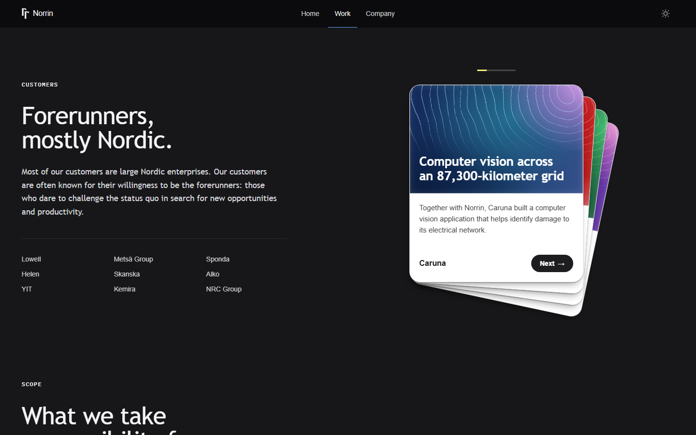
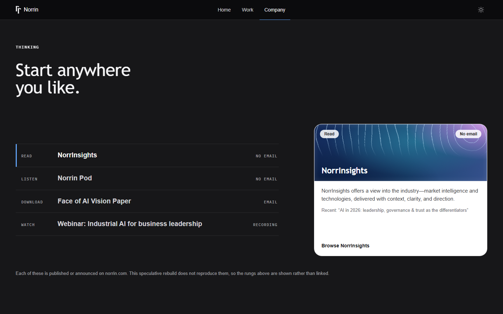

# Norrin redesign

An unsolicited redesign of a real company's website, built only from what they publish.

It's a speculative piece and it stays one. I have no brief, no analytics, no access to anyone
at Norrin, and none of this is endorsed by them.

**Live:** https://norrin-redesign.vercel.app


## What's in it

Three pages:

| Page | Sections |
|---|---|
| `/` | Hero, The Gap, Pillars, Contact |
| `/work` | Customer cases, Roles, Track record |
| `/company` | Thinking, Careers |





There are also four review pages. They aren't in the nav; you open them by adding a hash to
the URL:

- `#styleguide`: the design system, rendered in both themes
- `#compare`: each norrin.com section beside its rebuilt version
- `#backdrops`: options for the picture behind The Gap
- `#fonts`: display-face candidates at real size

## Run it locally

You need Node.js. There's no database, API key or backend; it's a static Vite site.

```bash
npm install
npm run dev       # http://localhost:5173
npm run build     # typecheck + production build
npm run preview   # serve the build at http://localhost:4173
```

## Checks

Every change has to pass these before it ships. The full rules are in [CLAUDE.md](CLAUDE.md).

```bash
npm run build
npm run lint                                    # oxlint, must report zero
node tools/palette.mjs                          # all 128 colour pairs meet contrast
node tools/audit.mjs http://localhost:4173/     # axe, light and dark (needs `npm run preview`)
node tools/shot.mjs --theme=dark                # screenshots, then look at them
```

Run the audit on `/work` and `/company` too, not just `/`. Axe doesn't check focus rings, so
check those by hand in both themes.

## Stack

React 19, Vite, Tailwind CSS v4, React Router 7 and Radix UI for interactive parts like tabs.
Scroll motion uses native CSS scroll-driven animations rather than a library, and every
animation respects reduced motion.

## Where things are

| Path | What it is |
|---|---|
| `src/data/norrin.ts` | all content, each string traced to a public Norrin page |
| `src/index.css` | the design system: colour tokens, type, cards, motion |
| `src/pages/` | one file per page, plus `SiteLayout` (nav, footer, scroll behaviour) |
| `src/components/sections/` | one file per section, plus the review pages |
| `src/routes.tsx` | the route table; `App.tsx` handles the review-page hashes first |
| `tools/` | photo encoding, screenshots, accessibility audit, contrast checks |
| `docs/` | research on Norrin and on other Nordic consultancies, plus design notes |
| `vercel.json`, `public/_redirects` | send every path to the app so `/work` and `/company` load directly |

## What this is not

Nothing here invents a statistic, client, testimonial or capability. Where content doesn't
exist publicly, it's left out.

- Customer names are set as type, because I hold no licence to their logos.
- The photos, the three Contact headshots and the logo mark in the navbar are Norrin's own,
  self-hosted. The alt text is mine.
- Two photographs sit under a dark overlay so text stays readable: the causeway behind
  Contact and the team photo behind Careers. Both are recorded exceptions in `CLAUDE.md` §1.8.

Known gaps:

- The type follows Norrin's own font roles (ABC Camera Plain and LFS Adelia), but those font
  files aren't included, so the site falls back to Helvetica and Trebuchet.
- A real build would still need attributed testimonials, licensed customer logos, real links
  behind the Thinking items and case studies, and a CRM behind the contact form.

Not affiliated with or endorsed by Norrin.
