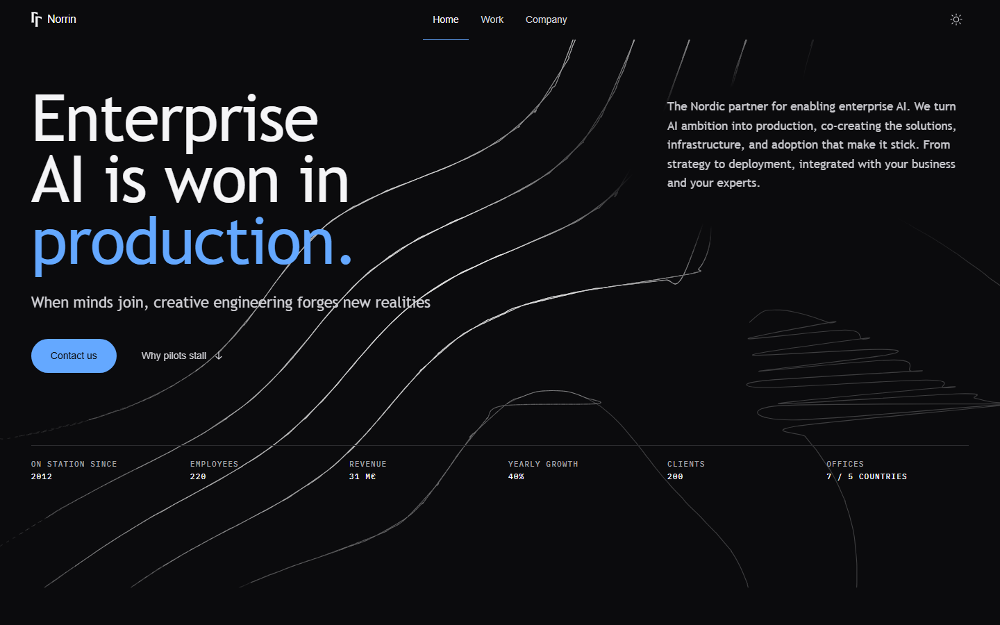
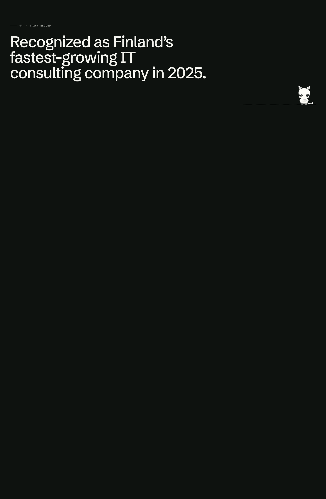

An unsolicited redesign of a real company's website, built only from what they publish.

hei I'm Anuj. This started as a design exercise and turned into an argument. Norrin's whole
pitch is one sentence — *"we believe enterprise AI is won in production"* — and on their own
homepage that sentence is an `h3` at 19.5px, two sections down, under a webinar promo. Their
`h1` is the company name, set at the same size as the paragraph beneath it. I wanted to see
what the site looks like when that sentence is the point. That's why this exists.

It's a speculative piece and it stays one. I have no brief, no analytics, no access to anyone
at Norrin, and none of this is endorsed by them. Deployed on Vercel.

**Live:** https://norrin-redesign.vercel.app

AI blurp starts from here:

Everything on the page is built to make one claim *visible* rather than merely stated. One
rule runs the length of the site. Left of the crossing it is dashed and lichen-grey —
provisional, a pilot, not load-bearing. Right of it the rule goes solid — committed, in
production. It is the only decorative device here, and it appears at five scales: the hero
horizon, the spine of the pilot→production diagram, the company timeline (where it inverts
cleanly for time — what happened is solid, what is ahead is dashed), the section rules, and
the line that finally completes edge-to-edge above the closing CTA. The argument is the
layout.



The hero: their thesis at display size with the `h1` it never had, their positioning
statement hung from the cap line of "Enterprise", and the six public figures they bury on
`/about-us` set as a station log. Nori stands in the notch beside the headline.

`01 The gap` draws that argument rather than describing it, and it is the one section that
re-lays-out rather than reflowing: at 320px the rule turns vertical and the three marks
become a rail.


`06 Careers` — the one band of norrin.com this site had no counterpart for, and the only
place with an animated photograph. The frame wipes in on `clip-path` as the section is read,
and the picture keeps travelling inside the fixed frame for as long as the section is on
screen.



`07 Track record` — the 2012 → 2024 merger → 2025 Sweden → 2027 listing arc, drawn on the
production line instead of left as one paragraph of prose.

Two surfaces hang off the hash rather than the page: **`#compare`** puts each section of
norrin.com beside the same section rebuilt, and **`#mascots`** is the pose workbench. Neither
is in the nav; the homepage should make the argument rather than talk about it.

## How it works

The palette is derived from **Norrin's own published theme tokens**, extracted from their
HubSpot theme CSS — not invented. Their system is a named Nordic nature palette (`moss`,
`sun`, `forest`, `lichen`, `sand`, `bark`, `sky`, `turquoise`) that their live site barely
exploits. Four survive as UI colours; seven nature colours is a mood board, not a system.

Every token is declared once via `light-dark()`, so `[data-theme]` is the only switch. Dark
is the default and it is in the markup — `<html data-theme="dark">` — not applied by script,
so the dark-first flash cannot happen and a visitor with JS off still gets the theme the page
was designed on.

| Token | Light | Dark | Role |
|---|---|---|---|
| `--ground` | `#f8f7f3` | `#0e120f` | page — warm paper, `sand`'s only survival |
| `--surface` | `#f1f0ea` | `#161b17` | alternating bands |
| `--inverse` | `#123e28` *(forest)* | `#16452c` | the two inverted sections — raised, not deepened, in dark |
| `--ink` / `-2` / `-3` | `#14170f` / `#4a4d42` / `#696d5f` | `#f2f2ec` / `#b4b8ac` / `#868a7c` | text levels |
| `--hairline` / `-strong` | `#d8d7cc` / `#b3b3a5` | `#292f2a` / `#404841` | **all** separation |
| `--accent` | `#1a5335` *(forest, lifted)* | `#9fb87e` *(sage)* | the only accent touching type or stroke |
| `--signal` | `#f6f279` *(sun)* | same | fill only, three uses per page |
| `--inactive` | `#88967e` *(lichen)* | `#5d6a55` | "not yet in production" — strokes only |

Three rules hold it together:

1. **Separation is 1px hairlines. There are zero box-shadows on the site.**
2. **Sun is a signal, never a surface.** Anything sitting on sun uses fixed dark ink in both themes.
3. **Radius means you can touch it.** Structure stays square — rules, bands, ruled tables, photographs. Only what responds is rounded.

Typography is three self-hosted families: **Schibsted Grotesk** (display and UI),
**Newsreader** (thesis, leads, case bodies), **IBM Plex Mono** (indices, unit labels,
telemetry). Norrin's own faces are available to this demo — it is private and built only to
show Norrin — but their heading face is a script, which in an enterprise-AI context costs
them authority.

## Nori

Nori is the mascot: a small white robot with a lavender antenna. `tools/nori.mjs` draws the
character once and emits every `public/nori-*.svg` — 13 poses plus a head crop used as the
nav mark and favicon. **The app never recolours or re-paths the drawings.** `Nori.tsx` places,
sizes and idles them and nothing else.

| Pose | Where it is used |
|---|---|
| `prop` | the hero, standing in the notch beside "Enterprise" |
| `sit` | `04 Customers` — seated on a rule |
| `peek` | `05 Thinking` — over a long ledge |
| `read` | `07 Track record` |
| `wave` | the footer |

Each pose is drawn to meet **one kind of edge** and they are not interchangeable. The rule
was learned the expensive way: **Nori may touch a rule, never type.** A white character with
a thin contour resting a hand on white ink has no visible contact point — every join that
works on this site is the mascot meeting a hairline, the production line, or a card border.
Idles pivot on a **measured contact point** (`anchors.ts`), not the box centre, so a figure
resting on a rule never lifts off it.

## Motion

**No animation library.** Reveals are an IntersectionObserver flipping one attribute over a
CSS resting state; everything continuous is a native scroll-driven animation. *No JS*, *no
IntersectionObserver*, *no scroll timelines* and *reduced motion* all degrade to the finished,
visible page — the earlier GSAP version set `autoAlpha: 0` inline and left copy permanently
invisible if a trigger misfired. Dropping GSAP cut **46 kB gzip**.

Every keyframe runs *from* a diminished state *to* the resting one, and every scroll rule
lives inside `@supports (animation-timeline: view())`. `.shots/anim.mjs` fails if one leaks
out.

## What's in the repo

| Path | Responsibility |
|---|---|
| `src/data/norrin.ts` | the single content source — every string provenance-commented against a public page |
| `src/index.css` | the whole design system: tokens, type roles, controls, the scroll-motion layer |
| `src/components/primitives/` | `Container`, `Grid`, `SectionHeader`, `Eyebrow`, `Reveal`, `SplitLines`, `Counter`, `Photo` |
| `src/components/mascot/nori/` | placement and sizing only, never repainting |
| `src/components/sections/` | one file per section, plus `Compare` and `MascotLab` |
| `src/pages/` | one file per route, plus `SiteLayout` — the shell every route renders into |
| `src/routes.tsx` | the five-route table; `App.tsx` still gates the hash surfaces ahead of it |
| `public/_redirects`, `vercel.json` | SPA fallback — Netlify and Cloudflare Pages read the first, Vercel reads the second |

### Why the host config looks the way it does

`vercel.json` states `framework`, `buildCommand` and `outputDirectory` rather than
leaving them to the dashboard, because the first deploy failed on exactly that gap:
`No Output Directory named "build" found after the Build completed`. The build had
already succeeded — Vite wrote `dist/` as it always does — and Vercel then went
looking in `build/`, which is Create React App's directory and has never been this
project's. `vercel.json` takes precedence over project settings, so declaring it here
means the deploy no longer depends on a setting invisible from the source tree.
`outputDirectory` is `dist` because that is Vite's default and `vite.config` does not
override it; if it ever does, the two move together.

The reasoning lives in this file and not in `vercel.json` because Vercel validates
that file against a strict schema and rejects unknown keys — including the `"//"`
convention normally used to smuggle a comment into JSON. It fails the deploy outright
rather than ignoring it.

The rewrite is what makes the five routes deep-linkable. The site is client-rendered
with no SSR, so `/work` exists only once React has booted; without a catch-all, every
route but `/` returns a 404 from the static host and the split ships broken for anyone
who does not enter through the homepage.
| `tools/nori.mjs` | draws the character once, emits all 13 poses + the mark |
| `tools/photos.mjs` | re-encodes Norrin's own photography to AVIF/WebP/JPEG at three widths |
| `tools/shot.mjs` | screenshot harness — viewports, themes, section clips, nav states |
| `tools/audit.mjs` | axe-core (incl. open nav drawer) + heading order + landmarks |
| `tools/palette.mjs` | every colour pair the system renders, declared and measured |

## Verified, not asserted

Four gates run alongside the build, and each one exits non-zero on a miss.

| Gate | What it proves |
|---|---|
| `node tools/palette.mjs` | 65 rendered colour pairs, alpha-composited onto their real backgrounds |
| `node tools/audit.mjs` | axe-core, light and dark, `wcag2a/2aa/21a/21aa` — **zero violations** |
| `node .shots/anim.mjs` | nothing displaced at rest, every scroll rule inside `@supports`, content visible in every degraded path |
| `npm run build` | `tsc -b` then Vite |

Contrast was a real finding, not a formality: `--ink-3` measured **3.67:1** and drove ~52
nodes of failure at 11px before being recomputed to `#696d5f` (4.96:1).

| | |
|---|---|
| JS | 273 kB / **83 kB gzip** (React 19 + ReactDOM is essentially all of it) |
| CSS | 56 kB / **12 kB gzip** |
| Fonts | **3 files, 117 kB** — latin-subset woff2 only, no italic, one mono weight |
| Photography | 6 images, AVIF/WebP/JPEG at 640/1280/1920, self-hosted, lazy below the fold |

Verified at 320 / 390 / 834 / 1280 / 1512. No horizontal overflow at 320px.

## Run it locally

You need Node.js and npm. There is no database, no API key and no service to sign up for —
it is a static Vite build.

```bash
npm install
npm run dev      # http://localhost:5173
```

```bash
npm run build    # typecheck + production build
npm run lint     # oxlint — must be zero
```

The QA harness needs the dev server already running in another terminal:

```bash
node tools/palette.mjs                          # 65/65 colour pairs
node tools/audit.mjs                            # axe, light + dark
node tools/shot.mjs --clip=hero --theme=dark    # one [data-shot] region
node tools/shot.mjs --all                       # every viewport
```

Two things that will save you a debugging session:

- **`tools/shot.mjs` takes `--clip=<name>`, not `--sections`.** The name is the value of a
  `data-shot` attribute: `hero`, `gap`, `roles`, `pillars`, `work`, `thinking`, `careers`,
  `proof`, `contact`, `footer`.
- **A `Photo` frame must be `overflow: clip`, never `overflow: hidden`.** `hidden` creates a
  scroll container, and a `view()` timeline inside one that never scrolls sits frozen at 0%
  forever — so the careers photograph silently stops animating and nothing errors.

## What this is not

Nothing here invents a statistic, client, testimonial, award or capability. Where content
does not exist publicly it is **absent rather than fabricated**. The customer roster is set
as type because I hold no licence to those marks, and there are no headshots for the same
reason. The photography is Norrin's own, self-hosted rather than hotlinked; the alt text is
mine, because five of their six homepage images ship with none.

Assumed, because no internal information was available: that the primary visitor is an
enterprise buyer at a large Nordic enterprise with candidates secondary, that the primary
conversion is a qualified conversation, and that the Anthropic + Microsoft alignment is
deliberate positioning.

A real build would still need testimonial quotes with attribution, licensed customer logo
files, real destinations behind the nav and case links, case metrics beyond the four Norrin
publishes, and CRM wiring.

Reasoning behind the decisions is in [docs/design-notes.md](docs/design-notes.md); the
evidence the redesign argues from is in [docs/research-brief.md](docs/research-brief.md).

Not affiliated with or endorsed by Norrin.
